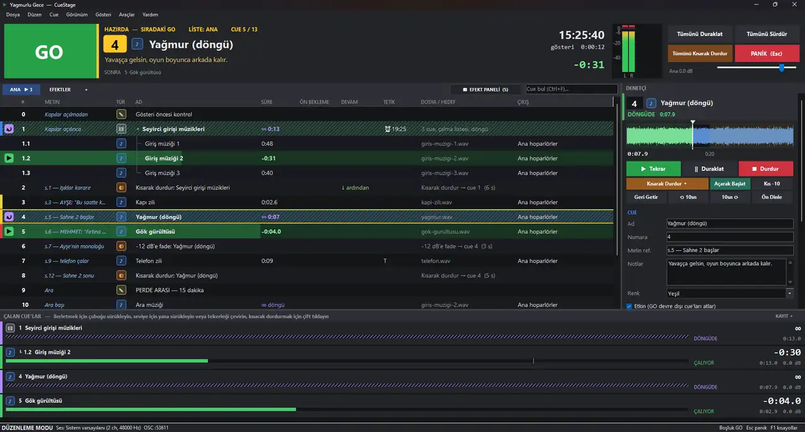

# CueStage

**Tiyatro ve okul gösterileri için ücretsiz ses ve gösteri kontrolü — Windows 10 / 11.**
Free sound and show control for theatre and school productions — Windows 10 / 11.

Gösterinin seslerini sıraya dizersin; her işarette GO'ya basarsın. Fade'ler, döngüler, efekt paneli, Gösteri Modu, gösteri öncesi kontrol, otomatik kayıt ve çökme kurtarma, MIDI / OSC / timecode.

## İndir / Download

**[En son sürüm / Latest release →](../../releases/latest)**

- `CueStage-1.0.0.zip` — program, Türkçe başlangıç rehberi (PDF), örnek gösteri. Kurulum gerekmez: zip'i aç, `CueStage.exe`'yi çalıştır.
- `CueStage-Rehberi.pdf` — 39 sayfalık Türkçe başlangıç rehberi.

Web: **https://cuestage.barish.dev**

## Windows uyarısı / SmartScreen

Program dijital olarak imzalı, ama Microsoft'un henüz tanımadığı bir imzayla. “Bilgisayarınız korundu” derse **Ek bilgi → Yine de çalıştır**. Zip'i açmadan önce sağ tık → Özellikler → **Engellemeyi kaldır** dersen uyarı hiç çıkmaz.

The program is signed, but with a certificate Windows doesn't recognise yet. If you see “Windows protected your PC”, choose **More info → Run anyway**, or right-click the zip → Properties → **Unblock** before extracting.

## Lisans / Licence

Ücretsiz kullanılabilir; tüm hakları saklıdır. Kaynak kodu bu depoda değildir. Ayrıntılar: [LICENSE.txt](LICENSE.txt), [THIRD-PARTY-NOTICES.txt](THIRD-PARTY-NOTICES.txt).

Free to use; all rights reserved. The source code is not in this repository. Details in [LICENSE.txt](LICENSE.txt).
